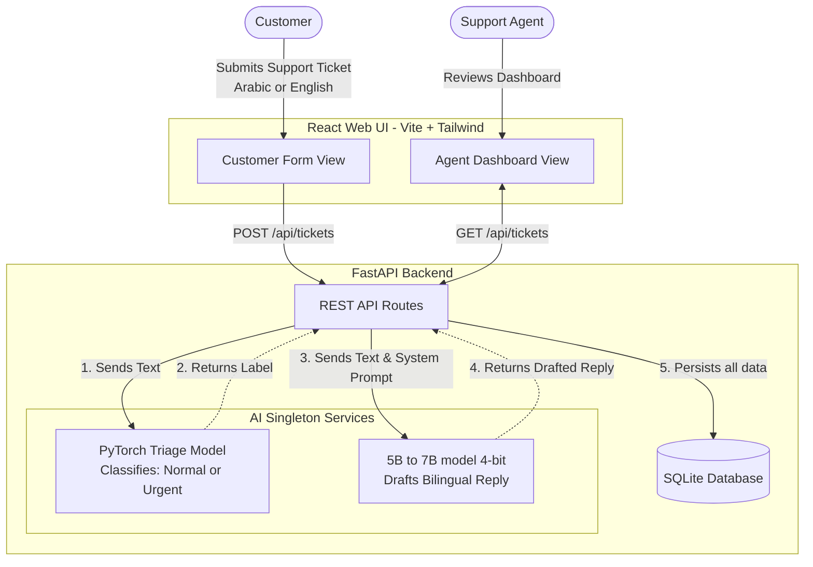

# Project Blueprint: Smart Ticketing System

## Project Overview

This project is a bilingual (Arabic/English) e-commerce customer support ticketing system. It satisfies three core academic requirements:

1. **Advanced Machine Learning:** A custom PyTorch model to classify ticket urgency.
2. **Local LLMs:** A locally fine-tuned and deployed model (7B Parameters) for drafting responses.
3. **Software Engineering:** A well-architected FastAPI backend with SQLite, integrated with a React frontend.

---

## System Architecture

The following diagram illustrates the flow of data from the moment a customer submits a ticket to when an agent reviews the AI-assisted draft.



---

## Complete Directory Structure

To keep the project organized and modular, separate the AI training pipelines from the production application code.

```text
ecommerce_ai_desk/
├── data/                       # Datasets for ML and LLM
│   ├── raw/
│   └── processed/
│
├── ml_pipeline/                # Phase 1: PyTorch Training
│   ├── preprocess.py           # Script to clean and balance reviews
│   ├── train_classifier.py     # Model definition and training loop
│   └── requirements.txt
│
├── llm_pipeline/               # Phase 2: Unsloth Fine-Tuning
│   ├── finetune.py     # Jupyter notebook for LoRA fine-tuning
│   └── requirements.txt
│
├── backend/                    # Phase 3: FastAPI Application
│   ├── core/
│   │   ├── config.py           # App settings and model paths
│   │   └── database.py         # SQLite connection and engine
│   ├── models/
│   │   ├── domain.py           # SQLAlchemy DB models (Ticket table)
│   │   └── schemas.py          # Pydantic validation models
│   ├── services/
│   │   ├── ml_service.py       # PyTorch Inference singleton class
│   │   └── llm_service.py      # LLM Inference (4-bit) singleton class
│   ├── api/
│   │   └── routes.py           # FastAPI endpoints (/api/tickets)
│   ├── saved_models/           # Exported AI weights
│   │   ├── triage_model.pth    # From ml_pipeline
│   │   └── llm-finetuned/     # From llm_pipeline
│   ├── main.py                 # App entry point (lifespan model loading)
│   └── requirements.txt
│
└── frontend/                   # Phase 4: React UI
    ├── src/
    │   ├── components/
    │   │   ├── CustomerForm.jsx
    │   │   └── AgentDashboard.jsx
    │   ├── services/
    │   │   └── api.js          # Axios API calls
    │   ├── App.jsx
    │   └── main.jsx
    ├── package.json
    └── tailwind.config.js
```

---

## Phase 1: Advanced Machine Learning (Triage Classifier)

**Goal:** Train a lightweight PyTorch model to classify incoming text as `0` (Normal) or `1` (Urgent/Angry).

* **Requirements & Libraries:** `torch`, `scikit-learn`, `pandas`, `numpy`, `nltk`.
* **Datasets:**
  * English: `IberaSoft/ecommerce-reviews-sentiment`
  * Arabic: `Ruqiya/Arabic_Reviews_of_SHEIN`

* **Tasks for AI Assistant:**
  * [ ] **Data Preprocessing:** Write a Python script to download, balance, and merge the datasets. Map negative reviews to `1` (Urgent) and neutral/positive to `0` (Normal).
  * [ ] **Tokenization:** Implement a simple text vectorizer (e.g., TF-IDF) or a PyTorch `nn.Embedding` layer with a vocabulary built from the training text.
  * [ ] **Model Architecture:** Create a PyTorch class `UrgencyClassifier(nn.Module)` using a Bi-directional LSTM or GRU, ending with a linear layer for binary classification.
  * [ ] **Training Loop:** Write the training script with CrossEntropyLoss, AdamW optimizer, and validation metrics (Accuracy, F1-Score).
  * [ ] **Export:** Save the final trained model weights as `backend/saved_models/triage_model.pth` and the vocabulary/vectorizer.

## Phase 2: Local LLM (Bilingual Response Generator)

**Goal:** Fine-tune to draft polite, e-commerce support responses in both Arabic and English.

* **Requirements & Libraries:** `unsloth`, `transformers`, `peft`, `trl`, `bitsandbytes`, `datasets`.
* **Dataset:** `bitext/Bitext-customer-support-llm-chatbot-training-dataset` (translate ~20% to Arabic for a bilingual mix).

* **Tasks for AI Assistant:**
  * [ ] **Dataset Formatting:** Write a script to convert the dataset into an Instruction/Input/Response JSONL format.
  * [ ] **Fine-Tuning Script:** Create a Jupyter Notebook or Python script using **Unsloth** to load a 7B model in 4-bit precision.
  * [ ] **LoRA Configuration:** Apply LoRA to standard attention modules to keep VRAM usage under 6GB during training.
  * [ ] **Training:** Use `SFTTrainer` to train the adapter for 1-2 epochs.
  * [ ] **Export:** Merge the LoRA weights and save the model locally to `backend/saved_models/llm-finetuned/`.

## Phase 3: Software Engineering (Backend & Database)

**Goal:** Build a robust, modular REST API that manages the database and serves the AI models efficiently.

* **Requirements & Libraries:** `fastapi`, `uvicorn`, `sqlalchemy`, `pydantic`, `transformers`, `torch`.

* **Tasks for AI Assistant:**
  * [ ] **Database Setup:** Create the `Ticket` table (id, user_message, language, urgency_level, ai_draft_response, status).
  * [ ] **Model Services (CRITICAL):**
    * Implement `ml_service.py` to load the PyTorch model and preprocessor.
    * Implement `llm_service.py` using `transformers` and `BitsAndBytesConfig(load_in_4bit=True)`.
  * [ ] **API Endpoints:**
    * `POST /api/tickets`: Accepts a user message. Calls ML service for urgency, calls LLM for draft response, saves to DB, returns JSON.
    * `GET /api/tickets`: Returns all tickets (sorted by urgency).
  * [ ] **Lifespan Manager:** Use FastAPI's lifespan context manager in `main.py` to load both models into GPU memory *once* on startup.

## Phase 4: Frontend Web UI (React)

**Goal:** Build the user interface for customers to submit tickets and agents to manage them.

* **Requirements:** `react` (via Vite), `tailwindcss`, `axios`, `lucide-react` (icons).

* **Tasks for AI Assistant:**
  * [ ] **Setup:** Initialize a Vite React project with TailwindCSS.
  * [ ] **Customer View (Component):** Create a simple form (`<textarea>`) for users to submit a complaint. Show a success message upon submission.
  * [ ] **Agent Dashboard (Component):**
    * Fetch tickets from `GET /api/tickets`.
    * Display them in a grid or list.
    * Apply color-coding based on the PyTorch urgency label (e.g., Red for `Urgent`, Gray for `Normal`).
    * Display the LLM's `ai_draft_response` with an "Approve & Send" button.
  * [ ] **API Integration:** Create an `api.js` file using `axios` to handle the backend communication.

## Phase 5: Deployment & Execution Strategy

**How to run the full stack (Instructions for the developer):**

1. Train ML model and place `triage_model.pth` in `backend/saved_models/`.
2. Train LLM and place adapter/merged model in `backend/saved_models/llm-finetuned/`.
3. Open terminal 1: `cd backend && uvicorn main:app --reload`
4. Open terminal 2: `cd frontend && npm run dev`
5. Access the app via `localhost:5173`

## Plan Synchronization

`smart-ticketing-system.md` is the source of truth for the high-level phases.
The detailed component plans contain additional implementation guidance and
include a generated **Master plan alignment** section so new phase changes can
be propagated without replacing that guidance.

Run a one-time synchronization after editing this file:

```powershell
.\sync-plan.ps1 -Once
```

To continuously watch this file and update the component Markdown files when
it changes, run:

```powershell
.\sync-plan.ps1
```

The watcher updates these files:

- `01-triage-ml-component.md` from Phase 1.
- `02-bilingual-llm-component.md` from Phase 2.
- `03-backend-component.md` from Phase 3.
- `04-frontend-and-deployment-component.md` from Phases 4 and 5.

Do not edit the generated alignment sections directly; edit the relevant
phase in this file and let the synchronizer propagate the change.
